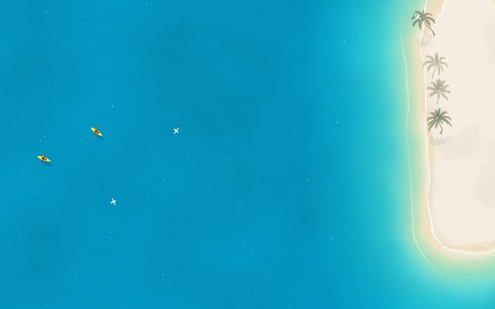
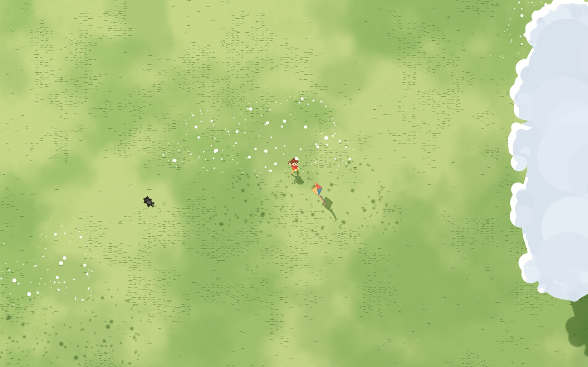
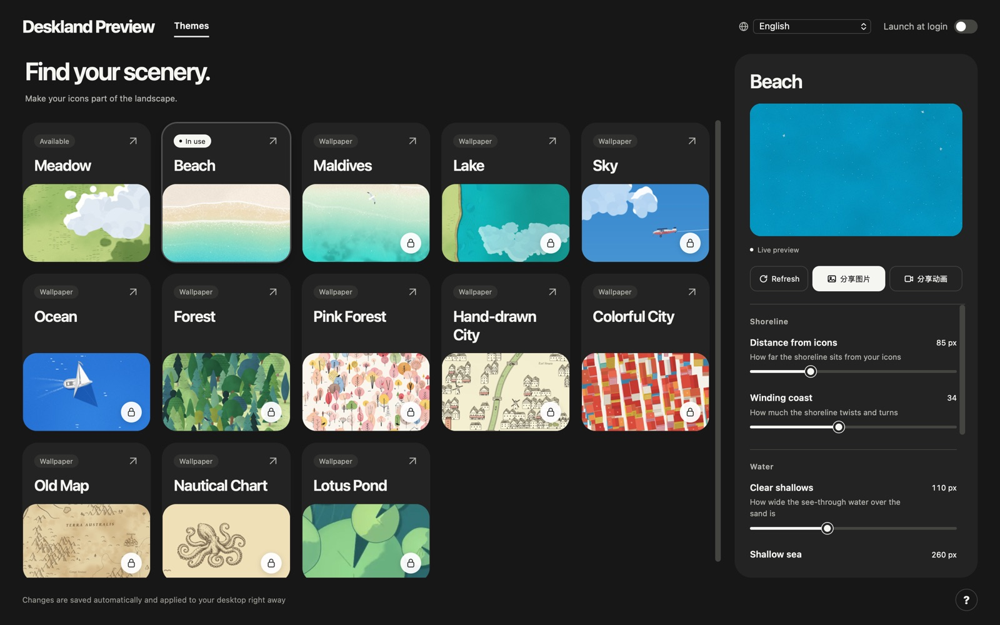

# DeskLand

A living wallpaper for macOS that reshapes its scenery around your desktop icons. Move, add or remove an icon and the beach or meadow quietly reshapes around it.

DeskLand is an independent macOS port of [Deskland Preview](https://github.com/BLEZZ0102/Deskland), a GPL-3.0 Windows app. It is not affiliated with or endorsed by the Deskland authors.

| Beach | Meadow |
| --- | --- |
|  |  |



## Features

- Two complete themes, Beach and Meadow, with every setting from upstream.
- Live settings window with a preview of your real icon layout.
- Pauses when another window fills the screen, when the displays sleep, or from the menu bar.
- Shares an image or animation that draws sample icons and color blocks, never a screenshot of your desktop.
- Launch at login.

## Requirements

- macOS 26 or later.
- Xcode 27.2 to build.
- Accessibility access, so DeskLand can read where Finder draws your desktop icons. Without it, the scenery fills the whole screen.
- Desktop icons turned on in Finder. If they're off, the theme has nothing to shape around.

## Build and run

Open `DeskLand.xcodeproj` and run the DeskLand scheme, or:

```sh
xcodebuild -project DeskLand.xcodeproj -scheme DeskLand -derivedDataPath DerivedData build
open DerivedData/Build/Products/Debug/DeskLand.app
```

To sign it yourself, set your own team in Signing & Capabilities.

DeskLand runs from the menu bar (the beach umbrella icon): Settings, Pause Animation, Reload, Launch at Login and Quit.

### Snapshot mode

```sh
DESKLAND_SNAPSHOT=/tmp/deskland-shots DerivedData/Build/Products/Debug/DeskLand.app/Contents/MacOS/DeskLand
```

Renders both themes and the settings page in offscreen windows with sample icons, saves PNGs and quits. It doesn't touch your desktop.

## How it works

| Part | macOS | Upstream (Windows) |
| --- | --- | --- |
| Wallpaper window | Borderless `NSWindow` at `desktopWindow + 1`: above the system wallpaper, below Finder's icons, on all Spaces, ignores the mouse | WebView2 window parented to `WorkerW` / `Progman` |
| Theme pages | `WKWebView` serving `WebContent/` from `deskland://app/` | WebView2 serving `https://app.local/` |
| Page bridge | Injected script that recreates `window.chrome.webview` on top of WebKit message handlers | WebView2's built-in `chrome.webview` |
| Icon positions | Finder's accessibility tree, every 400 ms | Desktop `SysListView32`, every 400 ms |
| Pause | Another window covers the screen, displays asleep, or manual | Foreground window maximized or full screen, or manual |

The theme pages in `WebContent/` are taken from upstream commit [`9818b57`](https://github.com/BLEZZ0102/Deskland/tree/9818b577402ff476e1b59da07970c56472713126/prototype), unchanged except for the "launch at login" strings in `i18n/`. `serve.mjs` was left out.

### Project layout

| Path | Contents |
| --- | --- |
| `DeskLand/App` | App delegate, menu bar, snapshot mode |
| `DeskLand/Wallpaper` | Wallpaper window, icon reader, cover detection |
| `DeskLand/Web` | `WKWebView` wrapper, URL scheme handler, `chrome.webview` shim |
| `DeskLand/Settings` | Settings storage, theme list, settings window |
| `DeskLand/Share` | Saving shared images and clips |
| `WebContent` | Theme pages, settings page and assets from upstream |

## Known limitations

- Only the primary display gets the wallpaper, as upstream.
- Icon reading hasn't been verified against every Finder layout. If the scenery doesn't line up with your icons, please open an issue with your macOS version and Finder icon size.
- Some upstream text still describes Windows (for example the wallpaper help). The settings page header still reads "Deskland Preview".

## Contributing

Issues and pull requests are welcome. See [CONTRIBUTING.md](CONTRIBUTING.md).

## License

DeskLand is licensed under the [GNU General Public License v3.0](LICENSE), the same as upstream. The theme code and assets in `WebContent/` are © the Deskland authors. See [NOTICE](NOTICE).

The GPL doesn't grant rights to the Deskland name or icon. Per upstream's [TRADEMARKS.md](https://github.com/BLEZZ0102/Deskland/blob/main/TRADEMARKS.md), modified distributions should use their own name and icon.
